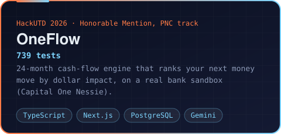
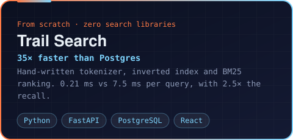
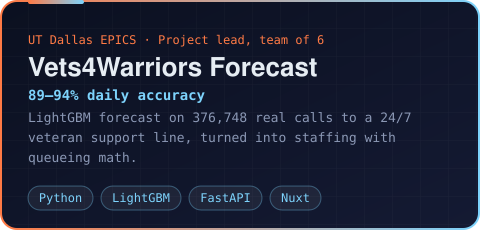
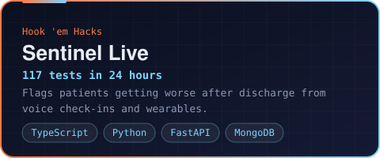
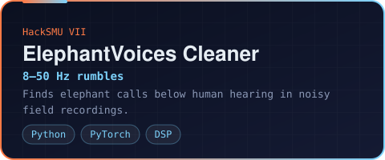
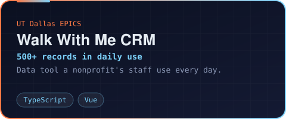

  

  
  
  
  

## 🚀 Featured work

  
  
  
  
  
  

## 🛠️ Experience

| When | Role | Where |
|---|---|---|
| Aug 2026 – now | **Project Lead**, call forecasting and staffing | Vets4Warriors · UT Dallas EPICS |
| Jan – Jun 2026 | **Software Developer**, data infrastructure | Walk With Me Global · UT Dallas EPICS |
| Jan – Mar 2026 | **Co-Founder and Technical Lead** | The Pakistani Magazine |
| Jun 2024 – Jun 2025 | **Founder and Lead Engineer**, 10+ client apps | Isloweb |

## 🧰 Toolbox

    
    
  

## 📈 Activity

  
  

<picture>
  <source media="(prefers-color-scheme: dark)" srcset="https://raw.githubusercontent.com/moaizattiq/moaizattiq/output/snake-dark.svg" />
  
</picture>

